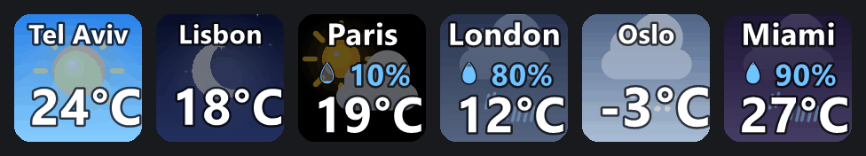
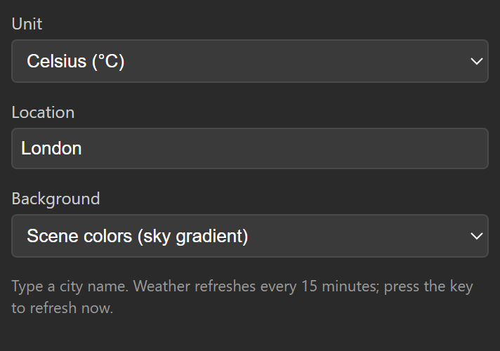

# soomfon-weather

A tiny StreamDock plugin for Soomfon Stream Controllers: current temperature plus an animated scene (sun, moon and stars, clouds, fog, drizzle, rain, snow, thunder) on a key. Data from [Open-Meteo](https://open-meteo.com) (no API key).

Options (per key, in the Property Inspector):
- **Unit**: Celsius (default) or Fahrenheit
- **Location**: free text city name
- **Background**: black, white, navy, slate, forest green, day/night (follows local time) or scene colors (sky gradient)
- **Slides**: what the key rotates through after the current weather, one slide a minute:
  - **Mix** (default): today's high/low, in 3 hours, tomorrow
  - **Today**: high/low, feels like, rain still to come today
  - **Hours**: +3h, +6h, +9h
  - **Days**: the next 3 days (high/low, chance of rain)

  Slides with nothing to say are skipped: "feels like" only when it is 3°C (5°F) off the real temperature, "rain today" only when rain is expected. Dots along the bottom show which slide is up.

Press the key to show the next slide (the 1-minute timer starts over). Weather refreshes every 15 minutes.

## Install

1. Copy `com.soomfonweather.sdPlugin` to `%APPDATA%\HotSpot\StreamDock\plugins\`
2. `cd com.soomfonweather.sdPlugin\plugin && npm install`
3. Restart Stream Controller, then drag **Weather** onto a key.

## How it works

`plugin/weather.js` geocodes and fetches current conditions plus the hourly and daily forecast, and `plugin/slides.js` turns that into the key's slides. `plugin/render.ps1` (PowerShell + System.Drawing) draws a 12-frame seamless loop per slide on each update, and `plugin/index.js` cycles the frames with `setImage` every 250 ms, so the animation costs only a websocket send per tick.
